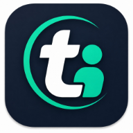
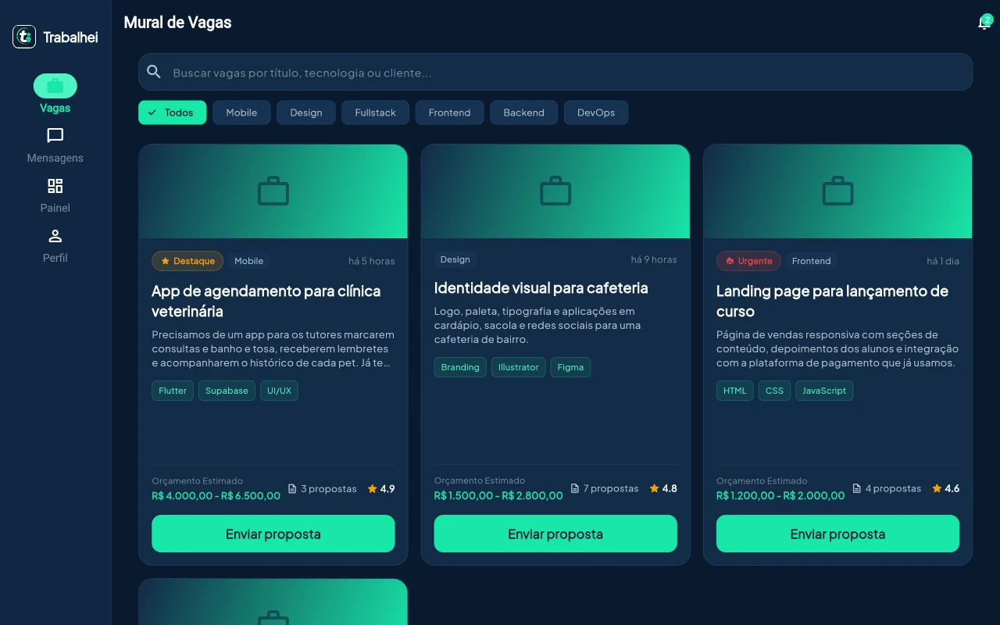
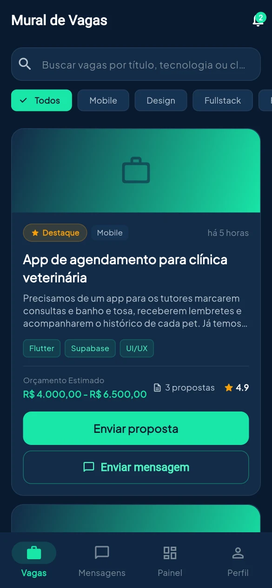
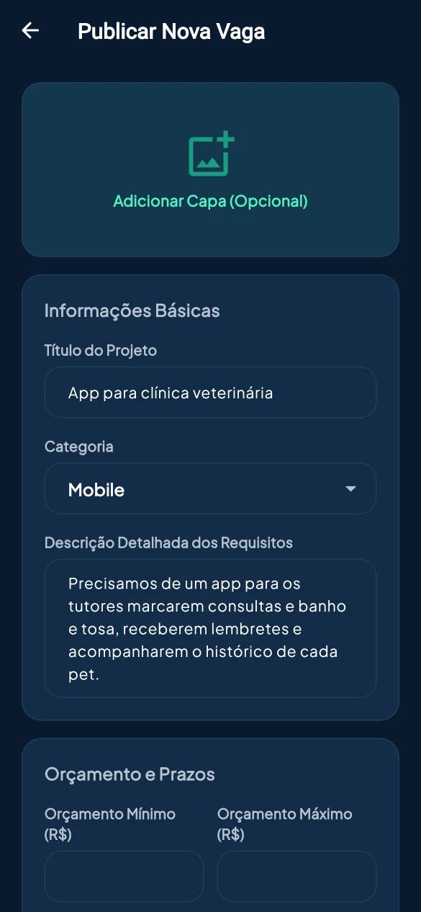
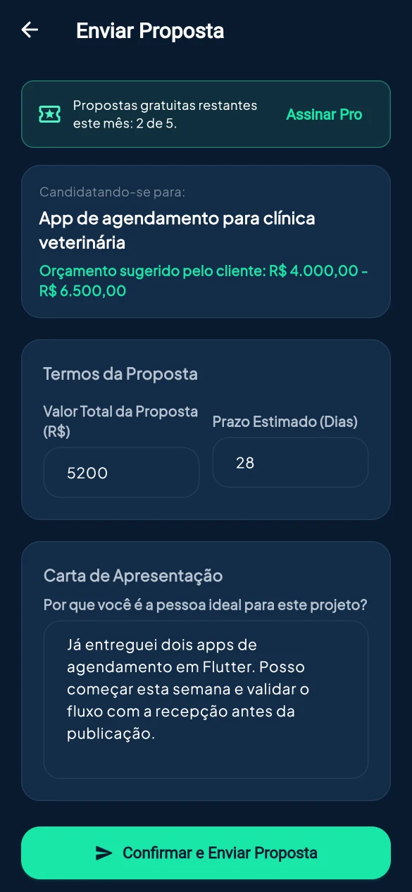
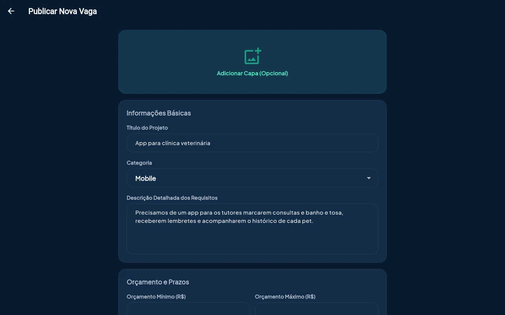
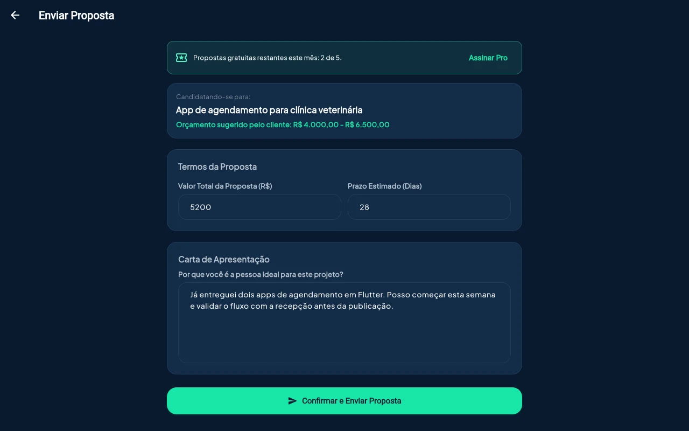
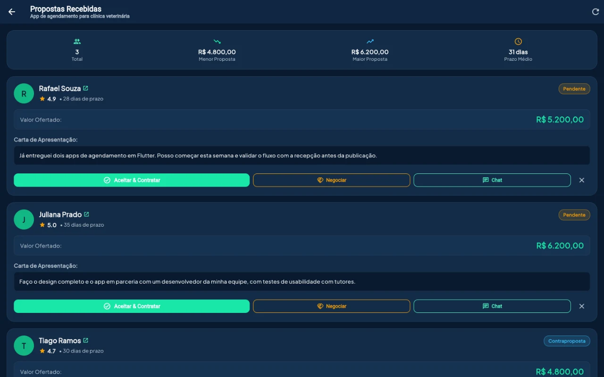
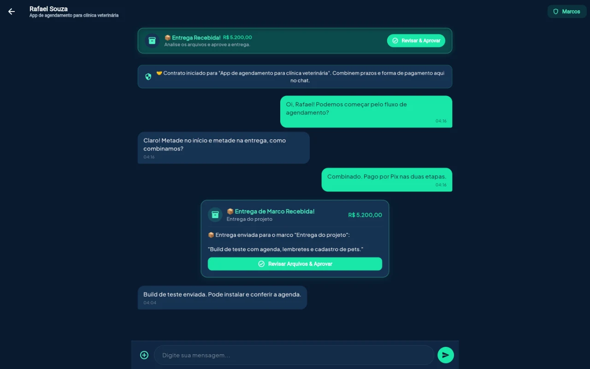

<div align="center">



# Trabalhei

**Freelancers e projetos, do anúncio à entrega.**

Plataforma brasileira de freelance, sem comissão sobre o valor dos projetos.
Propostas, chat e entregas por marcos em um só lugar, no Android, no Windows e no navegador.

[**Abrir a versão web**](https://trabalhei.site/app) ·
[Site](https://trabalhei.site) ·
[Baixar o app](https://github.com/Louizricard/Trabalhei/releases/latest) ·
[YouTube](https://www.youtube.com/@Trabalheiapp) ·
[Discord](https://discord.gg/ZcYQYVQYcM) ·
[Documentação](docs/)


<br>



</div>

---

## Sumário

- [Sobre](#sobre)
- [Principais recursos](#principais-recursos)
- [Telas](#telas)
- [Casos de uso](#casos-de-uso)
- [Como usar](#como-usar)
- [Modelo de negócio](#modelo-de-negócio)
- [Tecnologias](#tecnologias)
- [Como foi feito](#como-foi-feito)
- [Estrutura do repositório](#estrutura-do-repositório)
- [Rodando localmente](#rodando-localmente)
- [Publicação e operação](#publicação-e-operação)
- [Qualidade](#qualidade)
- [Contribuindo](#contribuindo)

## Sobre

O Trabalhei conecta quem precisa de um serviço a quem sabe fazê-lo. O cliente publica uma vaga com
categoria, orçamento e prazo. Freelancers enviam propostas, as partes conversam em tempo real,
acompanham a entrega por marcos e, no fim, se avaliam.

Em muitas plataformas de freelance, uma parte de cada projeto fica com o site. Aqui o valor combinado
é pago **diretamente entre cliente e freelancer**, sem comissão e sem custódia. O Trabalhei se mantém
com dois produtos opcionais: o plano **Pro** para freelancers e o **destaque** de vagas.

O mesmo código roda em Android, iOS e Web (e em Windows, com instalador próprio), e a conta é a mesma
em todas as versões.

## Principais recursos

| | |
|---|---|
| **0% de comissão** | O valor da proposta aceita vai inteiro para quem trabalha. |
| **Mural de vagas** | Busca por título, tecnologia ou cliente e filtros por categoria. Dá para explorar sem criar conta. |
| **Propostas comparáveis** | Valor, prazo e carta de apresentação lado a lado, com menor e maior valor e prazo médio. |
| **Negociação** | O cliente pode aceitar, fazer uma contraproposta ou chamar o freelancer no chat antes de contratar. |
| **Chat em tempo real** | Conversa do contrato com anexos, entregas e pedidos de revisão registrados. |
| **Entrega por marcos** | O cliente revisa os arquivos e aprova cada marco ou pede revisão. |
| **Avaliações de quem trabalhou junto** | Só quem concluiu um contrato avalia, então a nota vem de projetos reais. |
| **Painel** | Contratos ativos, propostas pendentes e projetos concluídos. |
| **Plano Pro e destaque** | Cobrança por Pix ou cartão via Asaas, aplicada só depois da confirmação do pagamento. |
| **Notificações** | Avisos de propostas, mensagens e entregas, com preferências por usuário. |

## Telas

Prints reais do app com dados fictícios de demonstração, gerados pelo próprio código
(veja [Como foi feito](#como-foi-feito)).

### Celular

<table>
  <tr>
    <td align="center" width="25%"><br><sub><b>Mural de vagas</b></sub></td>
    <td align="center" width="25%"><br><sub><b>Publicar vaga</b></sub></td>
    <td align="center" width="25%"><br><sub><b>Enviar proposta</b></sub></td>
    <td align="center" width="25%"><br><sub><b>Propostas recebidas</b></sub></td>
  </tr>
  <tr>
    <td align="center" colspan="4"><br><sub><b>Chat do contrato e entrega de marco</b></sub></td>
  </tr>
</table>

### Desktop e web

<table>
  <tr>
    <td align="center"><br><sub><b>Publicar vaga</b></sub></td>
    <td align="center"><br><sub><b>Enviar proposta</b></sub></td>
  </tr>
  <tr>
    <td align="center"><br><sub><b>Propostas recebidas</b></sub></td>
    <td align="center"><br><sub><b>Chat do contrato</b></sub></td>
  </tr>
</table>

## Casos de uso

### Quem contrata

> *Uma clínica veterinária precisa de um app de agendamento.*

1. Publica a vaga com título, categoria, descrição, orçamento e prazo. Capa e anexos são opcionais.
2. Recebe propostas e compara valores e prazos na mesma tela.
3. Aceita uma proposta, negocia com uma contraproposta ou conversa antes no chat.
4. Acompanha a entrega pelo chat do contrato e aprova ou pede revisão a cada marco.
5. Avalia o freelancer ao concluir.
6. Opcional: destaca a vaga por 7 dias para ela aparecer no topo do mural como patrocinada.

### Quem trabalha

> *Uma freelancer de design e Flutter procura projetos de mobile.*

1. Navega pelo mural, busca por tecnologia e filtra por categoria.
2. Envia a proposta com valor, prazo e carta de apresentação.
3. Se for contratada, combina detalhes no chat e entrega os arquivos por marco.
4. Recebe a avaliação do cliente, que passa a compor a nota do perfil.
5. Acompanha no painel os contratos ativos, as propostas pendentes e os projetos concluídos.
6. Opcional: no **Pro**, usa modelos de proposta, organiza clientes e projetos e vê estatísticas.

### Quem só quer olhar

Vagas e perfis abertos podem ser vistos no navegador sem cadastro. A conta só é pedida na hora de
enviar uma proposta ou publicar.

## Como usar

| Plataforma | Como acessar |
|---|---|
| **Web** | Abra [trabalhei.site/app](https://trabalhei.site/app) no Chrome, Edge, Firefox ou Safari (funciona também no iPhone). |
| **Android** | Baixe o `.apk` em [Releases](https://github.com/Louizricard/Trabalhei/releases/latest) (Android 8.0 ou mais novo). Se o sistema pedir, permita instalar apps dessa fonte. |
| **Windows** | Baixe o instalador `.exe` ou o `.zip` portátil em [Releases](https://github.com/Louizricard/Trabalhei/releases/latest) (Windows 10 ou 11, 64 bits). O app ainda não tem assinatura digital, então o SmartScreen avisa na primeira vez: clique em "Mais informações" e depois em "Executar assim mesmo". |

Depois é só criar a conta, confirmar o e-mail e escolher se vai contratar ou trabalhar. Quem prefere
rodar o projeto por conta própria encontra o passo a passo em [Rodando localmente](#rodando-localmente).

## Modelo de negócio

O Trabalhei **não custodia pagamentos**. O valor do projeto é combinado e pago diretamente entre
cliente e freelancer. A plataforma monetiza com:

| Produto | Quem paga | Como funciona |
|---|---|---|
| **Cliente** | Grátis | Publicar projetos, receber propostas, conversar e acompanhar entregas |
| **Freelancer grátis** | Grátis | Perfil, portfólio, 10 propostas por mês, chat e entregas |
| **Freelancer Pro** (mensal) | Freelancer | 50 propostas, modelos de proposta, clientes e projetos, estatísticas e arquivos maiores |
| **Destaque de projeto** (7 dias) | Cliente | Espaço identificado como patrocinado no topo do mural, em rodízio |

Pagar não dá prioridade na busca: a ordem do mural considera compatibilidade com o perfil, avaliações
e trabalhos concluídos. Os destaques ficam em um espaço próprio, sempre marcado como patrocinado.

Preços e limites ficam no banco (`billing_products` e `platform_settings`), e cupons em `coupons`:
veja [docs/monetizacao.md](docs/monetizacao.md). A cobrança é feita pelo **Asaas**: Pix pago dentro do
app (QR Code) e cartão na página segura do Asaas, sem que o app ou o banco toquem em dados de cartão.
O plano ou destaque só é aplicado quando o webhook confirma o pagamento.

## Tecnologias

| Camada | Escolha | Por quê |
|---|---|---|
| App | Flutter e Dart | Um código-fonte para Android, iOS, Web e Windows |
| Estado | Riverpod (`flutter_riverpod`) | Pouco boilerplate, seguro em compilação e bom com streams (chat em tempo real) |
| Navegação | `go_router` | Deep links e URLs reais na Web |
| Backend | Supabase: PostgreSQL, Auth, Storage e Realtime | Realtime resolve o chat e o SDK em Dart é oficial |
| Funções de servidor | Edge Functions em Deno e TypeScript | Cobrança, webhook e exclusão de conta fora do cliente |
| Pagamentos | Asaas (Pix e cartão) | Faturas hospedadas, sem tocar em dados de cartão |
| Monitoramento | Sentry | Erros do app e falhas 5xx das funções |
| Hospedagem | Vercel (web e homepage), GitHub Releases (APK e Windows) | |
| CI | GitHub Actions | Análise, testes, build de APK e testes do banco |

Outras bibliotecas: `fl_chart` (estatísticas), `google_fonts`, `image_picker`, `file_picker`,
`url_launcher`, `shared_preferences`, `intl` e `uuid`.

## Como foi feito

### Arquitetura do app

O app segue **Clean Architecture organizada por feature**. Cada pasta em `lib/features/` (`auth`,
`jobs`, `proposals`, `chat`, `billing`, `dashboard`, `profile`, `notifications`, `admin`) se divide em
`domain` (regras e entidades), `data` (repositórios e acesso ao Supabase) e `presentation` (telas e
widgets). A injeção de dependência é o próprio grafo de providers do Riverpod.

### Regras no banco, não no cliente

Toda mudança de estado sensível (aceitar proposta, entregar ou aprovar marco, cota do plano) acontece
em funções do banco (`SECURITY DEFINER`). O cliente só tem permissão de escrita nas colunas que pode
editar, e cada tabela tem políticas de RLS documentadas em [docs/rls.md](docs/rls.md). O schema evolui
só por migrations versionadas, cada uma com rollback em `supabase/rollbacks/`.

### Cobrança sem custódia e sem duplicidade

O checkout cria a cobrança no Asaas por Edge Functions e o plano só é liberado quando o **webhook**
confirma o pagamento. O webhook é idempotente e transacional: eventos repetidos, fora de ordem ou
com falha de gravação não aplicam o benefício duas vezes. Estornos e chargebacks revertem o que foi
concedido. Os detalhes estão em [docs/checkout-asaas.md](docs/checkout-asaas.md),
[docs/webhook-asaas.md](docs/webhook-asaas.md) e [docs/reversoes-cobranca.md](docs/reversoes-cobranca.md).

### Testes

- Testes de widget e unidade do Flutter (`flutter test`).
- Suítes de SQL e Deno contra um PostgreSQL descartável, cobrindo webhook, checkout, estornos,
  reversões e exclusão de conta, com chamadas concorrentes, expiração de lease e replays.
- O CI roda tudo a cada push e pull request.

### Prints gerados pelo próprio código

As telas deste README vêm de um app de demonstração em `freelanceflow/tool/showcase`, que usa os mesmos
widgets do app com repositórios em memória e dados fictícios. Um script automatiza a captura e o
redimensionamento, então os prints acompanham o visual real do produto.

### Homepage

A homepage em `site/` é HTML, CSS e JavaScript puros, sem etapa de build. Os botões de download leem a
última versão do GitHub Releases, e o SEO inclui `sitemap.xml`, `llms.txt` e JSON-LD.

## Estrutura do repositório

```
freelanceflow/        App Flutter (lib/, test/, android/, ios/, web/ ...)
  tool/showcase/      App de demonstração e scripts que geram os prints
site/                 Homepage pública (raiz de trabalhei.site; o app fica em /app/)
supabase/
  migrations/         Schema, RLS e funções (RPC) do banco (só migrations de ida)
  rollbacks/          Rollback de cada migration (<versão>_<nome>_down.sql), fora do alcance do CLI
  functions/          Edge Functions (Deno): cobrança Asaas, webhook e exclusão de conta
  templates/          E-mails de autenticação em português (cadastro, senha, etc.)
    _shared/          Código comum (importado como ../_shared/common.ts)
  tests/              Suítes de webhook, checkout, estornos, reversões e exclusão
docs/                 Documentação de cobrança, RLS, produção e exclusão de conta
scripts/              Build do Vercel, SEO e instalador do Windows
```

## Rodando localmente

Pré-requisitos: Flutter estável, [Supabase CLI](https://supabase.com/docs/guides/local-development) e Docker.

```bash
# 1. Backend local (aplica supabase/migrations)
supabase start

# 2. App (use a URL e a chave exibidas pelo `supabase start`)
cd freelanceflow
cp dart_defines.example.json dart_defines.json   # edite SUPABASE_URL e SUPABASE_ANON_KEY
flutter pub get
flutter run --dart-define-from-file=dart_defines.json
```

O app não lê arquivos `.env`: a configuração entra em tempo de compilação via `--dart-define`.

## Publicação e operação

<details>
<summary><b>Projeto Supabase na nuvem</b></summary>

```bash
supabase link --project-ref <ref>
supabase db push                                  # aplica as migrations
cp supabase/.env.example supabase/.env           # preencha os segredos do Asaas
supabase secrets set --env-file supabase/.env
supabase functions deploy asaas-create-subscription asaas-cancel-subscription asaas-feature-job asaas-webhook delete-account
```

Antes do `db push`, `supabase migration list` deve mostrar as mesmas versões no local e no remoto.
Os rollbacks ficam em `supabase/rollbacks/` e são aplicados à mão (`psql -f`), nunca pelo CLI.

As funções importam o código comum de `../_shared/common.ts`; o CLI empacota isso sozinho. Se publicar
por outro meio (painel, MCP), envie os arquivos com o mesmo layout (`<função>/index.ts` e
`_shared/common.ts`, entrypoint `<função>/index.ts`) para o código publicado ser idêntico ao do repositório.

No painel do Asaas, cadastre o webhook em `https://<ref>.supabase.co/functions/v1/asaas-webhook`
com o mesmo token de `ASAAS_WEBHOOK_TOKEN`, envio sequencial e os eventos listados em
[docs/producao.md](docs/producao.md) (item 5). A produção usa `ASAAS_BASE_URL=https://api.asaas.com/v3`.
Sem essa variável as funções usam o sandbox, útil para testes locais (o passo a passo da troca está em
`docs/producao.md`).

O processamento transacional e a recuperação do webhook estão documentados em
[docs/webhook-asaas.md](docs/webhook-asaas.md), incluindo publicação, rollback e testes.

</details>

<details>
<summary><b>App web no Vercel</b></summary>

O `vercel.json` chama `scripts/vercel-build.sh`, que baixa a versão fixada do Flutter e roda
`flutter build web`. Variáveis do projeto no Vercel (Production e Preview):

| Variável | Valor |
|---|---|
| `SUPABASE_URL` | URL do projeto Supabase |
| `SUPABASE_ANON_KEY` | Chave publicável do Supabase |
| `SENTRY_DSN` | Opcional; DSN do projeto Flutter no Sentry |

O ambiente enviado ao Sentry vem de `VERCEL_ENV` (production/preview). Produção: `https://trabalhei.site`
(DNS no Vercel; `www` redireciona para o domínio principal e `trabalhei.vercel.app` continua respondendo).

O build publica a pasta `dist/`: a homepage (`site/`) na raiz e o app Flutter em `/app/`
(`--base-href /app/`). Links antigos do app (`/#/login`, links de e-mail com `?code=...`) e o app
instalado como PWA são levados para `/app/` por um script no topo de `site/index.html`.

</details>

<details>
<summary><b>Versões para Android e Windows</b></summary>

```bash
cd freelanceflow
flutter build apk --release --dart-define-from-file=dart_defines.json      # assinado com key.properties
flutter build windows --release --dart-define-from-file=dart_defines.json
cd ..
powershell -ExecutionPolicy Bypass -File scripts/windows-installer/build.ps1
```

O `build.ps1` gera em `release/` o ZIP portátil e o instalador `.exe`, montado pelo IExpress (já vem no
Windows). O instalador copia o app para `%LOCALAPPDATA%\Programs\Trabalhei` sem pedir administrador,
cria o atalho no menu Iniciar e registra a desinstalação em "Aplicativos instalados". O executável não
tem assinatura digital, então o Windows SmartScreen avisa na primeira execução.

</details>

<details>
<summary><b>Homepage e prints (<code>site/</code>)</b></summary>

Os botões de download leem a última versão do GitHub Releases: o `.apk` vira o botão do Android,
`*-windows-*-setup.exe` o instalador do Windows e `*-windows-*.zip` o ZIP portátil. Se a consulta
falhar, os botões levam à página de versões. O aparelho em destaque muda com a tela
(`html[data-mode]`, definido no `<head>`): notebook em telas largas e deitadas, celular nas demais.
Preços citados no texto (Pro e destaque) devem acompanhar `billing_products`.

SEO: `robots.txt`, `sitemap.xml` (atualize o `lastmod` ao mudar a página), `llms.txt` para buscadores de
IA e JSON-LD (organização, app e perguntas frequentes). O JSON-LD das perguntas é gerado no build por
`scripts/site-seo.mjs` a partir das próprias perguntas da página. O app em `/app/` tem `noindex`.

Para regenerar os prints:

```bash
cd freelanceflow
flutter build web -t tool/showcase/main.dart -o build/showcase
python -m http.server 8091 --directory build/showcase   # em outro terminal
BROWSER="<caminho do Edge ou Chrome>" node tool/showcase/capture.mjs <pasta>
BROWSER="<caminho do Edge ou Chrome>" node tool/showcase/resize.mjs <pasta>/phone-jobs.png:../site/assets/screens/phone-jobs-sm.webp:585
```

Os destaques da demonstração guiada (`DEMO_STEPS` em `site/assets/js/site.js`) usam posições em %
de cada print; ao trocar um print, confira se continuam no lugar.

</details>

<details>
<summary><b>Monitoramento (Sentry)</b></summary>

Erros não tratados do app e falhas 5xx das Edge Functions (incluindo o webhook do Asaas) vão para o
Sentry quando `SENTRY_DSN` está definido; sem ele, nada é enviado. No app, defina `SENTRY_DSN` no
Vercel (ou no `dart_defines.json`); nas funções, `supabase secrets set SENTRY_DSN=...`. O Sentry
avisa por e-mail a cada novo tipo de erro.

</details>

## Qualidade

```bash
cd freelanceflow
flutter analyze
flutter test
```

O CI (`.github/workflows/ci.yml`) roda os dois comandos a cada push e pull request, além do build do
APK debug. Também executa as suítes de [webhook](docs/webhook-asaas.md) e
[checkout Asaas](docs/checkout-asaas.md) com PostgreSQL descartável.

## Contribuindo

Regras para contribuidores e agentes de IA: [AGENTS.md](AGENTS.md) e `.agents/rules/`. Em resumo:
não remover funcionalidade sem autorização, mudar o schema só com migration reversível, não deixar
segredos no código e manter Android, iOS e Web funcionando. Os commits seguem Conventional Commits.
